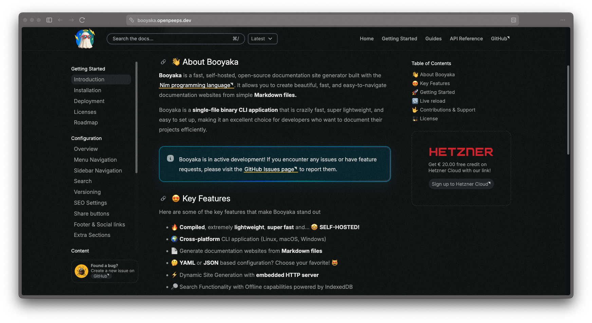

<p align="center">
  <br>
  Booyaka &mdash; A fast documentation generator for cool kids!<br>
  Compiled &bullet; Lightweight &bullet; Fast &bullet; Written in Nim
</p>

<p align="center">
  <code>nimble install booyaka</code> | <a href="https://github.com/openpeeps/booyaka/releases">Download from GitHub</a>
</p>

<p align="center">
    
</p>



## Key Features
- Compiled, lightweight, and fast; fully self-hosted
- Cross-platform CLI application (Linux, macOS, Windows)
- Generate documentation websites from Markdown files
- Build online book-style websites directly from Markdown
- Embedded HTTP server with dynamic site generation
- Static site generation with the `build` command
- Client-side fuzzy search with offline support
- Browser Sync and Live Reload while writing documentation
- YAML or JSON based configuration
- Responsive UI powered by Bootstrap 5
- Light, dark, and system themes with a theme switcher
- Left and right sidebars: manual navigation or auto-generated table of contents
- Nested table of contents and bottom previous/next page navigation
- Configurable code syntax highlighting with line numbers and copy buttons
- Custom themes with automatic fallback to the built-in theme
- Template-level custom routes: static Tim views or remapped Markdown pages
- Lazy loading for iframes, videos, audio, and images
- Customizable with project CSS and JavaScript
- AI share buttons for ChatGPT, Claude, Gemini, and GitHub Copilot
- Optional Git-based versioning and contributors information
- Print-friendly layout for PDF export
- SEO metadata support
- Open Source | AGPLv3 License

> [!NOTE]
> Booyaka is still in active development. Expect frequent updates and new features as we work towards a stable release.

## About
Booyaka is a documentation site generator that takes a directory of Markdown files and generates a
fully functional documentation website, then serves it dynamically using an embedded HTTP server.
It can also export a complete static HTML website for hosting anywhere.
It is designed to be simple, fast, and easy to use.

Booyaka is written in [Nim language](https://github.com/nim-lang), a statically typed compiled systems
programming language that combines the performance and low-level control of C with the expressiveness
and ease of use of modern languages like Python and Ruby. [Learn more about Nim](https://nim-lang.org).

## Installation
Download the precompiled binaries from the [releases page](https://github.com/openpeeps/booyaka/releases)
or use `nimble` to build from source. Read the [Nim installation guide](https://nim-lang.org/install.html)
if you don't have Nim installed.

### Prerequisites
- [Nim](https://nim-lang.org/install.html) >= 2.2.10

```
nimble install booyaka
```

## Getting Started

Create a new Booyaka project by running the following command, replacing `<directory>` with the
path of the directory you want to create the documentation site from:

```
booyaka new <directory>
```

Booyaka will create a new directory with the necessary files and folders to get started. Navigate to
the newly created directory and start the embedded HTTP server:

```
cd <directory>
booyaka start . --port=8000 --sync
```

Open your web browser and go to `http://localhost:8000` to view your documentation site. The `--sync`
flag enables Browser Sync and Live Reload while you write.

To generate a static HTML website for hosting, run:

```
booyaka build <directory>
```

## CLI
| Command | Description |
|---|---|
| `booyaka new <directory>` | Create a new Booyaka project (`--json` for a JSON config) |
| `booyaka theme <name>` | Scaffold a blank theme in `./<name>` (copy it into `themes/`) |
| `booyaka start <directory>` | Start the embedded HTTP server (`--port`, `--sync`, `--devMode`) |
| `booyaka build <directory>` | Generate a static HTML website (requires `metadata.url`) |

## Configuration
Booyaka reads a `booyaka.config.yaml`, `booyaka.config.yml`, or `booyaka.config.json` file in the
project directory (`booyaka new` generates one for you; pass `--json` for the JSON variant).
Each section below is optional except `metadata.url`, which `booyaka build` requires.

### Server
Controls the embedded HTTP server used by `booyaka start`. The `--port` flag overrides `port`.
```
server:
  address: "127.0.0.1"
  port: 3000
  threads: 1      # 1 = single worker, 0 = one per CPU core
  unix: false     # true = serve over a Unix socket at `address` instead of TCP
```

### Theme
Name of the active theme, resolved from `<project>/themes/<name>`. Templates missing from the
active theme fall back to the built-in `default` theme. Scaffold a blank theme with
`booyaka theme <name>`, then copy or symlink it into `themes/` and activate it here.
```
theme: "default"
```

### Metadata
Site identity and SEO basics. `url` accepts a bare host (`website.com`,
`openpeeps.github.io/carne`) or a full URL; its path prefix (e.g. `/carne`) is applied to every
asset and page link so the static site also works from a subdirectory.
```
metadata:
  url: "openpeeps.github.io/carne"
  title: "Booyaka Documentation"
  description: "A documentation website built with Booyaka"
  keywords: ["booyaka", "documentation", "docs"]
  logo: "/assets/booyaka.png"   # optional, defaults to the built-in logo
  logo_keep_gradient: false     # true keeps the logo's original colors
```

### Appearance
```
appearance:
  show_theme_switcher: true     # light/dark switcher in the header
  default_theme: "system"       # "system" follows the OS, or pin "light" / "dark"
  show_toggle_left_sidebar: true
  show_toggle_right_sidebar: true
  background_noise_opacity: 0.03  # 0.0 disables the background texture
```

### Git
```
git:
  enable_versioning: false      # version switcher from semver git tags
  enable_contributors_info: false
  latest_label: "main"          # label of the working-tree version
```

### Header
```
header:
  search:
    enable: true
    index_meta_data: true
    index_page_titles: true
  notification: ""              # optional HTML banner shown in the header
```

### Content
Rendering options for Markdown pages.
```
content:
  allowed_raw_html_tags: ["b", "i", "strong", "em", "a", "p", "ul", "ol", "li"]
  show_last_updated: true
  last_date_updated_format: "yyyy-MM-dd HH:mm:ss"
  enable_auto_format_links: true
  bottom_navigation: true       # previous/next links at the bottom of pages
  code_line_numbers: false      # CSS line numbers on fenced code blocks
  highlight_strip_lines: true   # trim blank lines around fenced code blocks
  share_ai_buttons: true
  share_buttons_ai_providers:   # each entry needs label, url, description (icon optional)
    - label: "ChatGPT"
      url: "https://chat.openai.com/"
      description: "Ask ChatGPT about this page"
  lazyload_iframes: false
  lazyload_videos: false
  lazyload_images: false
  page_references: true         # `@page.md` links render as rich page cards
```

### Navigation
Top navbar and sidebar sections. Sidebar `url` values need a leading slash and should match
page slugs so previous/next links and highlighting resolve.
```
navbar:
  - title: "Home"
    url: "/"
    icon: ""

sidebar_navigation:
  - name: "Getting Started"
    items:
      - title: "Introduction"
        url: "/"
        icon: ""
      - title: "Installation"
        url: "/install"
        icon: "icon-download"
```

Extra sidebar widgets accept raw HTML or Markdown content:
```
extra_sections:
  left_sidebar:
    - title: ""
      content: ""
  right_sidebar:
    - title: ""
      content: ""
```

### Footer
```
footer:
  text: ""
  links:
    - title: "GitHub"
      url: "https://github.com/example"
      icon: "icon-brand-github"
```

### Adding template-level routes
You can define custom routes at Booyaka config level. A `view` route renders a Tim template
directly, which lets any documentation site grow fully custom pages. A `page` route serves a
Markdown file from `contents/` at an explicit path instead of its natural slug (the original
URL is then excluded from the build, search index, and page cards).
```
routes:
  - path: "/contact"          # static Tim view
    view: "pages/contact"     # -> themes/<theme>/views/pages/contact.timl
    title: "Contact"           # meta fallback (no Markdown involved)
  - path: "/changelog"        # Markdown-backed
    page: "releases.md"       # served here; /releases is excluded
    layout: "base"            # default layout (frontmatter wins)
```
Each route sets exactly one of `view` or `page`. Markdown pages can override the view and
layout per file with frontmatter (`view:` / `layout:`, defaulting to the `index` view and the
`base` layout). The homepage (`/`) plus `/search`, `/results.json`, `/llms.txt`, and `/assets`
stay reserved. Custom routes work the same in `booyaka start` and `booyaka build`; restart the
dev server after adding a brand-new view file.

## Roadmap
Here are some planned features and improvements for future releases:

- [ ] UI mobile-optimized refinements
- [ ] Inline Markdown editor for content editing
- [ ] Feedback and commenting system
- [ ] Authentication for private documentation
- [ ] Multi-language support

### Contributions & Support
- Found a bug? [Create a new Issue](https://github.com/openpeeps/booyaka/issues)
- Want to help? [Fork it!](https://github.com/openpeeps/booyaka/fork)

### License
AGPLv3 license. [Made by Humans from OpenPeeps](https://github.com/openpeeps).<br>
Copyright OpenPeeps & Contributors &mdash; All rights reserved.
